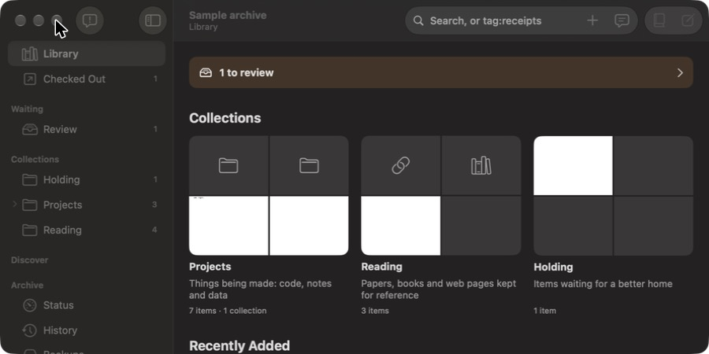
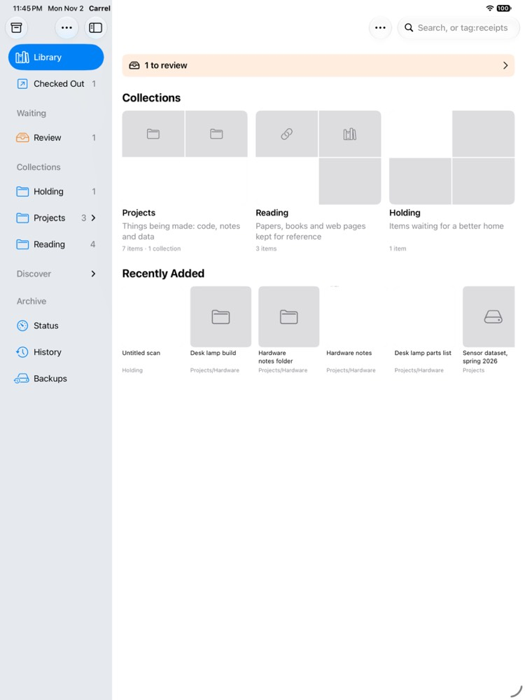

# Design: the Library, and a sidebar around what owners do

Status: accepted 2026-11-02, with the five decisions below. Issue #512.

## What this adds

Opening an archive greeted the owner with Status, a dashboard, and a sidebar that led with work queues (Review, Questions, Restructure, Active, Flagged). The owner's direction: the collection itself is the star. An archive opens on its contents, shown in a way that invites browsing; adding is a mode to switch on; and the queues draw attention only when there's something to decide.

## What owners do, most often first

1. Browse and rediscover what's there.
2. Find one thing (search).
3. Add something: a file, a web address, a note.
4. Decide what Carrel queued: review, questions, restructure proposals, flags.
5. Work with checked-out items.
6. Look after the archive: status, history, backups, sync.

The old sidebar was close to the reverse.

## How similar apps do it

- **Photos** on Mac and iPad opens on the Library itself. Its sidebar has pinned items, then albums, then a Utilities section at the bottom (Imports, Duplicates, Recently Deleted).
- **Music** opens on the library.
- **DEVONthink** keeps an Inbox for unfiled items at the top of the sidebar, beside the databases and smart groups.
- **Readwise Reader** separates what's kept (Library) from what waits to be dealt with (Inbox), and expects the Inbox to be cleared.
- **Mail** shows what needs attention as badges on rows, not as a screen of its own.
- In all of them, adding is a button or a drop, not a place to go.

## The sidebar

```text
Library              ← opens here
Checked Out      2   ← only when anything is checked out or on the desk

LIBRARIAN            ← only when it's asking anything; tinted, with badges
  Questions      1   ← its questions for you
  To Approve     5   ← what it filed or found, for your OK (Review)
  Suggestions    3   ← restructure proposals (Restructure)
  Flags          1   ← what you flagged, and its answers (Flagged)
                     ← each row only when it has any

COLLECTIONS
  ▸ Reading     42
  ▸ Projects    17
    Holding      4

ARCHIVE
  Status · History · Backups
```

The section of queues is framed around **the librarian**: it's the librarian asking you things, so the section names it and its rows say what's being asked. "Needs You" and "Waiting" were dropped, and "Inbox" isn't used because Carrel already uses it for each device's queue of changes for the writer. The rows' names are used in titles, menus and help in every interface; the commands keep theirs (`carrel questions`, `carrel review`, `carrel restructure`, `carrel flagged`). **Checked Out** is the screen called Active before; its links and `carrel tui active` keep the name `active`. A screen that's showing keeps its row while it's empty, so approving the last proposal doesn't pull the row out from under the owner.

## The Library page

- **Collections as covers:** the top-level collections, each with a few of its newest items' thumbnails, its title, its description and how many items it holds, nested collections included. Holding comes last. Choosing one opens it, as in the sidebar.
- **Recently Added:** the newest items, by the day they were filed.
- **On This Day:** a card from what was made, filed or worked on on this day in other years, when there's anything.
- **A line from the librarian** when it's asking anything, such as "The librarian has 1 question and 5 items for you to approve." Each part opens its screen, and the line goes when nothing is asked.
- **An empty archive** invites adding: "Drop files here or choose + to add."

Restricted items never appear on a cover.

In the apps the Library's Covers is a page as wide as the window, beside the sidebar, as Photos' Library is; the other views and screens keep their list beside the inspector.

| Mac | iPad |
| --- | --- |
|  |  |

## Discover becomes views

Discover leaves the sidebar. Its pages are ways of looking at the archive, as Finder's and Photos' view modes are, so the Library and every collection have a **view switcher** in the toolbar:

| View | Was | What it shows, for the Library or the chosen collection |
| --- | --- | --- |
| **Covers** | (new) | Collections as covers; the Library's own |
| **Items** | Browse's list and grid | The items, as a list or a grid; a collection's own |
| **Timeline** | Discover → Timeline | Items by when they're from |
| **Map** | Discover → Archive Map | The structure, sized by contents |
| **Connections** | Discover → Connections | How items and collections relate |
| **Activity** | Discover → Activity | What was added and changed, and when |

- **The views are scoped.** In a collection, each covers that collection and those inside it (`Catalog::within`); in the Library, the whole archive. Covers is the Library's alone.
- **The last view is remembered** for the Library and for each collection.
- **On This Day** is a card on the Library's Covers, not a page.
- **Wander** is a button on the Library and in each collection that starts a walk from a random item there (`Catalog::pick`).
- **Names that stay:** `carrel discover …` commands keep theirs, and `carrel://open?screen=discover:…` links open the matching view of the Library (`discover:wander` a wander).

## Adding is a mode

- **The + button** in the toolbar, **File → Add Items…** (⌘N, which the window doesn't otherwise use: New Archive is ⇧⌘N), and dropping anywhere on the window add to the archive. On the Mac, + and ⌘N open the **Add panel**; dropping goes straight to the add sheet, as before.
- **The Add panel** holds what Status's intake section held: choosing files, a web address, a note or the clipboard, and the intake queue with the worker's progress.
- **Intake leaves Status,** which keeps one line saying what's being added.

## In each interface

- **The core** (`carrel_core::library`) computes the Library from the discovery catalog: the shelves with their counts and covers, Recently Added, and how many are flagged. It decides which Librarian rows show and names them (`Waiting::rows`, `Queue::title`), and words the librarian's line and its parts (`Waiting::line`, `Waiting::parts`). `library::View` lists each scope's views. The apps reach them through `ArchiveHandle.library`, `waitingRows`, `librarianAsks`, `archiveViews` and the views' `within` in the FFI.
- **The command line:** `carrel library` prints the same: the librarian's line, the shelves with their counts and descriptions, Recently Added and On This Day, or one JSON value with `--json`. `carrel discover map`, `activity`, `graph` and `wander` take `--in COLLECTION` for a collection's view (the timeline takes `collection:` as search does).
- **The interactive mode** uses the same order in its row of tabs: **1 Library**, **2 Checked Out**, **3 Questions**, **4 To Approve**, **5 Browse**, **6 Status**, **7 History**, **8 Backups**, **9 Settings**, **L Librarian**. Checked Out, Questions and To Approve are left out of the row while they're empty, as the sidebar leaves them out; their keys still work. It opens on Library: the librarian's line and its rows, the shelves with counts, Recently Added and On This Day, each a row that `Enter` opens. Suggestions are in To Approve there (`f` switches its lists) and Flags on Status, so their rows open those. Discover is no longer a tab: `v` on the Library, or on a collection in Browse, cycles through its views, `w` wanders from a random item there, and `Esc` goes back. Adding is a key, not a tab: `+` shows the intake queue, and `i` adds from anywhere, as before. `carrel tui library` starts on it.
- **The Mac app, iPad and iPhone** use the same sidebar, with the switcher and **Wander** in the toolbar; on iPhone, Library is the first screen. `carrel://open?screen=library` and `carrel gui library` open it. On iPad and iPhone the + menu also has Photos, Take Photo and Scan Document, and **Show Queue…** opens the Add panel as a sheet.

## Building it

1. The core's `library` module, and this design (#512).
2. `carrel library`, and the interactive mode's Library and order (#512).
3. The FFI's `library`, and the apps' Library page, sidebar and Add panel (#512).
4. `docs/design/mac-app.md`, the user guide and the Mac app's guide, which the wiki publishes (#512).
5. The Librarian section, and Discover's pages as scoped views, in every interface (#512, after #513).

## Decisions (accepted 2026-11-02)

1. **Every archive opens on a Library of its contents,** in every interface. Recommended: browsing and rediscovering is what owners do most, and it's what Photos and Music open on.
2. **The section of queues is the Librarian's:** Questions, To Approve, Suggestions and Flags, shown only when it's asking anything, each row only when it has any, with badges, and a line from it on the Library. Recommended: it is the librarian asking, Mail's badges draw attention without a screen of their own, and "Inbox" already means each device's queue of changes.
3. **Adding is a mode:** +, ⌘N and dropping open the Add panel, which takes Status's intake section; Status keeps one line. Recommended: adding is a button or a drop in every comparable app, not a place.
4. **Discover's pages become views of the Library and of each collection,** in a switcher, scoped and remembered; On This Day is a card and Wander a button. Recommended: they're ways of looking, as Finder's and Photos' view modes are, more useful for one collection than only for the whole archive, and the sidebar stays short.
5. **Status, History and Backups go under an Archive heading at the bottom.** Recommended: looking after the archive is what owners do least often, as Photos keeps Utilities at the bottom.
